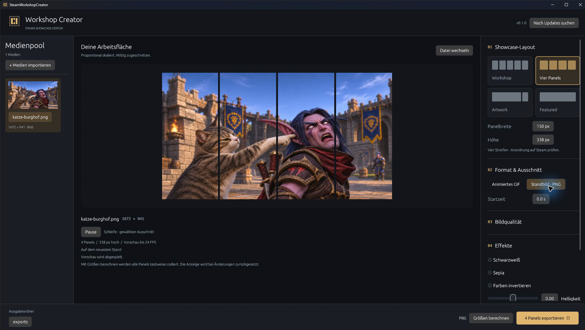
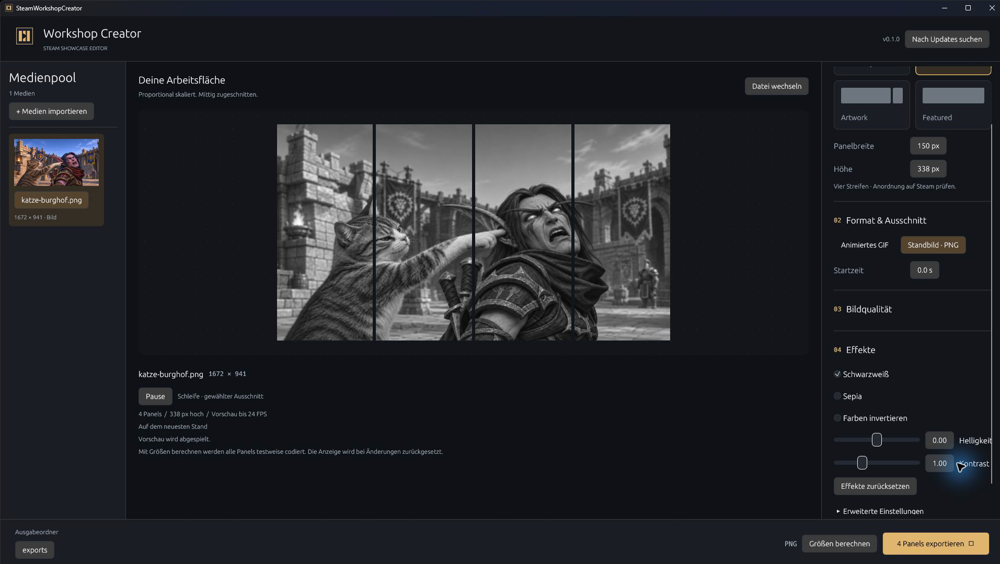
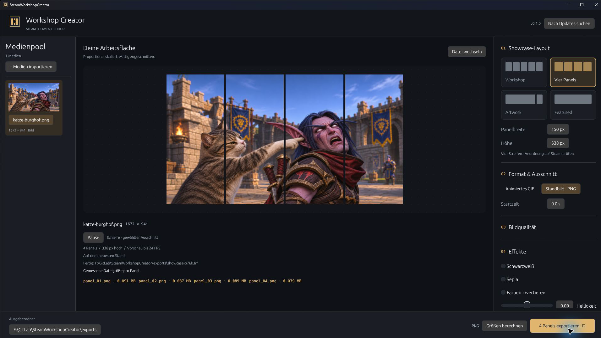
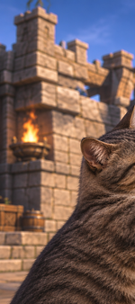
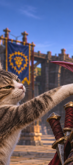
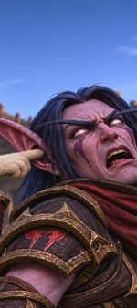
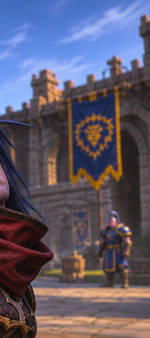

> **Dieses Projekt wurde mithilfe von KI erstellt.**

# SWC – SteamWorkshopCreator

Native Rust-Desktop-App zum Zuschneiden von Videos, GIFs und Bildern für Steam-Profil-Showcases. Eine eigenständige Neuimplementierung, inspiriert von [steam-showcase-maker](https://github.com/VOiD-Ayush/steam-showcase-maker).

[](https://github.com/LalisaTM/SWC-SteamWorkshopCreator/actions/workflows/ci.yml)

## Herunterladen

Die aktuelle Windows-x64-EXE steht unter **[GitHub Releases](https://github.com/LalisaTM/SWC-SteamWorkshopCreator/releases/latest)** bereit. `SWC-SteamWorkshopCreator-windows-x64.exe` herunterladen und starten. Keine separate FFmpeg-Installation erforderlich. Es ist eine portable Anwendung ohne Installer und ohne Konsolenfenster.

## Screenshots

Die folgenden Aufnahmen zeigen die echte Windows-App mit der Beispielvorlage „Katze ärgert Nachtelfen-Schurken im Burghof“. Das [Beispielbild](docs/examples/katze-burghof.png) wurde für diese Dokumentation bereitgestellt. Es handelt sich um ein Standbild; deshalb zeigt das Beispiel einen PNG-Export.

### Medienpool und Vorschau

Das Bild wird links in den Medienpool importiert. Rechts sind vier Streifen mit jeweils **150 × 338 Pixeln** eingestellt. In der Mitte zeigt die Vorschau die Aufteilung des Motivs.



### Effekte direkt in der Vorschau

Hier ist der Schwarzweiß-Effekt aktiviert. Die Quelldatei im Medienpool bleibt unverändert; die Vorschau zeigt den Effekt auf den Panels.



### Export und gemessene Dateigrößen

Für diesen Export ist Schwarzweiß wieder deaktiviert. Nach dem Speichern zeigt die App die tatsächlich erzeugte Dateigröße für jedes der vier PNG-Panels an.



Die erzeugten Dateien liegen unter [docs/examples/export](docs/examples/export). Von links nach rechts ergeben sie wieder das zugeschnittene Motiv:

<p>
  
  
  
  
</p>

Die [Export-Einstellungen und Dateigrößen](docs/examples/export/manifest.json) sind ebenfalls enthalten. Die Screenshots zeigen den lokalen Editor und keinen bereits auf Steam veröffentlichten Showcase.

## Automatische Updates

Beim Start prüft die App im Hintergrund die neueste stabile GitHub-Release. Ein manueller Check ist oben über „Nach Updates suchen“ möglich. Liegt eine neuere Version vor, erscheint „Update installieren & neu starten“. Dieser Klick lädt die Release-EXE, prüft die SHA-256-Prüfsumme und ersetzt die bisherige Anwendung. Die App speichert ihre Einstellungen, schließt und startet die neue Version. Während eines Exports ist die Installation gesperrt.

Das Programm benötigt Schreibrechte im eigenen Ordner. Beim Neustart wird der Medienpool der aktuellen Sitzung geschlossen; importiere die Quelldateien danach erneut. Die Updateprüfung überträgt keine Medien, sondern ruft die öffentliche GitHub-Releases-API ohne Token auf. Ohne Internet funktioniert der Editor weiterhin. Fehler werden in der App angezeigt. Es werden nur stabile Releases aus diesem Repository berücksichtigt, keine Vorabversionen oder ältere Versionen. Die Prüfung schützt vor beschädigten Downloads; die EXE ist derzeit nicht mit einem Windows-Code-Signing-Zertifikat signiert.

## Starten

Unter Windows x64 enthält die EXE FFmpeg und ffprobe bereits. Nutzer benötigen weder eine separate Installation noch einen PATH-Eintrag oder einen Download beim Start. Beim ersten Medienzugriff werden die eingebetteten Dateien automatisch in `%LOCALAPPDATA%/SteamWorkshopCreator/tools/` entpackt. Integritätsprüfungen erkennen beschädigte Dateien und stellen sie aus der EXE wieder her.

Zum Bauen wird Rust benötigt. Der erste Windows-Build lädt automatisch das festgelegte FFmpeg-9.0.2-Archiv von Gyan.dev und prüft dessen SHA-256. Weitere Builds verwenden den lokalen Cache unter `vendor/ffmpeg/`. Für Offline-Builds dieses Archiv vorab mit `scripts/prepare-ffmpeg.ps1` bereitstellen. Die SHA-256-Prüfung erfolgt auch beim Build. Unter anderen Betriebssystemen werden FFmpeg und ffprobe weiterhin im PATH benötigt.

```powershell
cargo run
```

Datei auswählen oder ins Fenster ziehen, Layout und Ausschnitt einstellen, Vorschau aktualisieren und exportieren. Jeder Export erzeugt einen eigenen Unterordner mit Panels, `manifest.json` und `UPLOAD.txt`. Bestehende Exporte werden nicht überschrieben. Die Einstellungen werden lokal gespeichert. Die App startet maximiert. Im Medienpool links lassen sich mehrere Dateien importieren (auch per Mehrfachauswahl oder Drag-and-drop). Ein Klick wählt das aktive Medium. Die Vorschau spielt den gewählten Ausschnitt in einer Schleife mit bis zu 24 FPS ab und lässt sich pausieren. Änderungen an Ausschnitt und Effekten aktualisieren die Vorschau automatisch. PNG zeigt ein Standbild. Der Pool bleibt während der aktuellen Sitzung erhalten; er ist keine Timeline zum Zusammenfügen mehrerer Clips.

## Layouts

| Preset | Dateien | Breite |
| --- | --- | --- |
| Workshop | 5 Streifen | je 150 px als Vorgabe, einstellbar |
| Vier Panels nebeneinander | 4 Streifen | je 150 px als Vorgabe, einstellbar |
| Artwork | Hauptbild + Seitenbild | 506 + 100 px |
| Featured Artwork | 1 Bild | 630 px |

Die Höhe ist frei wählbar (bis 8192 px). Das Motiv wird proportional auf die gesamte Layoutfläche skaliert und mittig zugeschnitten. Optional werden zwischen den Panels Pixel des Motivs ausgelassen, um Lücken in einer Showcase-Darstellung zu berücksichtigen. Beispiel: Artwork mit 8 px Abstand verwendet eine 614 px breite Motivfläche. Bei Abstand 0 werden die Teile nahtlos geschnitten.

Die Artwork-Maße stammen aus dem verlinkten [Steam-Community-Guide](https://steamcommunity.com/sharedfiles/filedetails/?id=748624905). Der Export ersetzt den dort beschriebenen manuellen Upload nicht. Vier Streifen werden technisch unterstützt; ein passendes Steam-Showcase mit genau vier gleichwertigen Slots ist damit nicht zugesichert. Es gibt keinen automatischen Steam-Upload.

## Motiv verschieben, skalieren und drehen

Die gemeinsame Panel- und Bearbeitungsansicht zeigt das aktive Bild, Video oder GIF mit den Panelgrenzen. Das Motiv lässt sich darin direkt auswählen und transformieren:

- Motiv anklicken: Auswahlrahmen und Griffe anzeigen.
- Im Motiv ziehen: Position verändern. Mit **Shift** bleibt die Bewegung auf einer Achse.
- Einen Eckgriff ziehen: proportional vergrößern oder verkleinern; die gegenüberliegende Ecke bleibt fest.
- Den runden Griff oberhalb des Rahmens ziehen: um die Motivmitte drehen. Mit **Shift** rastet die Drehung in 15°-Schritten ein.
- **Escape** während des Ziehens: die laufende Änderung zurücknehmen.
- **Strg+Z**: rückgängig; **Strg+Y** oder **Strg+Shift+Z**: wiederholen. Ein Ziehvorgang zählt als ein Schritt. Die Befehle gelten auch für Effekte und Exportvorgaben.
- **Pfeiltasten** bei ausgewähltem Motiv: um einen Ausgabepixel verschieben; **Shift+Pfeiltaste**: zehn Pixel.

Rechts unter **Transformieren** sind Position X/Y in Ausgabepixeln, Skalierung von 5 bis 400 % und Drehung von −180 bis 180° auch numerisch einstellbar. **Transformation zurücksetzen** stellt die mittige Ausgangsposition bei 100 % ohne Drehung wieder her. Die Ausgangsgröße füllt die gesamte Showcase-Fläche proportional aus; ein überstehender Teil des Motivs wird beim Export abgeschnitten. Sichtbar freigelegte Flächen bleiben schwarz.

Das **Mausrad** zoomt um den Mauszeiger; **Ansicht +/−** und **Einpassen** steuern ebenfalls nur die Editoransicht. Mit gedrückter **mittlerer Maustaste** lässt sich die Ansicht verschieben. Bearbeitung und Panelgrenzen bleiben dabei in derselben Ansicht. Auswahlrahmen und Hilfslinien werden nicht exportiert. Die Regler und Griffe reagieren direkt, auch wenn die Wiedergabe pausiert ist. Effekte und Zeitraum werden weiterhin im Hintergrund für die Vorschau vorbereitet.

Transformationen werden während der Sitzung pro Medium im Medienpool behalten. Die übrigen Export- und Effektvorgaben bleiben gemeinsame Einstellungen. Der Export und die Größenanalyse verwenden die aktuelle Transformation; zuvor berechnete Größen werden nach einer Änderung verworfen. Es handelt sich um eine feste Transformation für den gesamten Ausschnitt, ohne Keyframes.

Auch die Kommandozeile unterstützt die Transformation. `--scale 0.75` entspricht 75 %:

```powershell
cargo run --features console -- export docs/examples/katze-burghof.png --layout strip4 --format png --height 338 --offset-x 20 --offset-y=-10 --scale 0.75 --rotation 15
```

GIF-Export unterstützt Zeitraum, FPS, Farbpalette, vier Dither-Verfahren und Schwarzweiß. PNG exportiert das erste Bild am Startzeitpunkt. Dateien über 5.000.000 Bytes werden markiert. Die Kompressionspresets Klein, Balance und Qualität setzen FPS, Farben und Dithering. Die optionale Zielgrößen-Automatik reduziert die Palette pro GIF bis auf vier Farben. Reicht das nicht, wird der Export mit einem Hinweis abgebrochen und aufgeräumt; dann FPS, Höhe oder Dauer reduzieren. Die Auflösung wird nicht automatisch verändert. Videos und GIFs dürfen mit dem gewählten Zeitraum nicht über ihr Ende hinausreichen. Statische Bilder können ebenfalls als GIF exportiert werden, ergeben dabei ein Einzelbild.

Der optionale experimentelle Workshop-Patch ersetzt das letzte GIF-Byte durch `0x21`, entsprechend dem Verfahren des Referenzprojekts. Er ist standardmäßig deaktiviert, weil er den normalen GIF-Trailer verändert. Community-Uploadverfahren können sich ändern; ein erfolgreicher Steam-Upload ist nicht lokal getestet.

## Effekte und Größenanalyse

Unter **Effekte → Farbkorrektur …** öffnet sich ein separates Fenster mit Vorschau, RGB-Histogramm und Originalvergleich. Temperatur, Tönung, Belichtung, Kontrast, Lichter, Tiefen, Helligkeit und Sättigung sowie Schwarzweiß, Sepia und invertierte Farben lassen sich dort einstellen. Bei Videos und GIFs zeigt der Farbkorrektur-Editor ein Standbild an der gewählten Startzeit. **Übernehmen** wendet die Korrektur als einen rückgängig machbaren Schritt an; **Abbrechen**, Escape oder Schließen verwerfen sie. Vorschau und Export verwenden dieselbe Farbverarbeitung. Die Einstellungen bleiben beim Medienwechsel als gemeinsame Exportvorgaben erhalten. Die Vorschau zeigt keine GIF-Palettenquantisierung.

**Snapping** in der Vorschau richtet das bewegte Motiv an Panelkanten, Panelmitten sowie Kanten und Mitte der gesamten Fläche aus. Türkise Hilfslinien markieren die Ausrichtung. **Alt** schaltet Snapping beim Ziehen vorübergehend aus; der Schalter in der Werkzeugleiste deaktiviert es dauerhaft für die Sitzung. **Shift** beschränkt die Bewegung weiterhin auf eine Achse.

Die Dateigrößen werden nach einer kurzen Bearbeitungspause automatisch im Hintergrund berechnet. Dazu codiert die App alle Panels mit den aktuellen Einstellungen in einem temporären Ordner. Weitere Änderungen brechen die alte Analyse ab; verspätete Ergebnisse werden verworfen. Die Oberfläche bleibt bedienbar. Die Analyse kann genauso lange dauern wie ein Export. Ihre temporären Dateien werden anschließend entfernt. Der endgültige Export zeigt die tatsächlich geschriebenen Größen erneut an.

Das neue Icon ist als Fenstericon und Windows-EXE-Ressource eingebettet. Für Windows-Builds wird der Resource Compiler aus den Visual Studio Build Tools benötigt.

## Kommandozeile

Der Standard-Build startet unter Windows ohne Konsole. Für die Kommandozeile aktiviert `--features console` die Konsolenausgabe.

```powershell
cargo run --features console -- export "video.mp4" --layout strip4 --height 600 --duration 3 --output exports
cargo run --features console -- export "bild.png" --layout artwork --format png --height 900 --gap 8
cargo run --features console -- export "video.mp4" --layout featured --height 900 --fps 15 --colors 64
cargo run --features console -- export --help
```

## Prüfen und Bauen

```powershell
cargo fmt --check
cargo test
cargo clippy --all-targets -- -D warnings
cargo build --release
```

`target/release/steam-workshop-creator.exe` ist die Windows-Anwendung. FFmpeg und ffprobe sind unter Windows x64 direkt eingebettet; die einzelne EXE kann auf einen anderen Rechner kopiert werden. Die Integrationstests erzeugen Testvideos und prüfen echte GIF-/PNG-Exporte aller Presets, Maße, Patch und Abbruchbereinigung. Fehlt FFmpeg, wird dieser Integrationstest übersprungen.

## Enthaltene Drittanbieter-Software

Eingebettet sind die unveränderten Programme ffmpeg und ffprobe aus FFmpeg 9.0.2 Essentials von [Gyan.dev](https://www.gyan.dev/ffmpeg/builds/), mit Lizenz, README, Buildkonfiguration und Quellcodeverweisen. Der nicht benötigte Player ffplay ist nicht eingebettet. Die beiden Hilfsprogramme laufen als separate Prozesse. `LICENSE-FFmpeg.txt` und `README-FFmpeg.txt` werden neben den Cache-Dateien bereitgestellt. Die FFmpeg-Binaries stehen unter GPLv3; deren Lizenz wird durch die MIT-Lizenz dieses Rust-Projekts nicht ersetzt.

Festes Archiv: `https://www.gyan.dev/ffmpeg/builds/packages/ffmpeg-9.0.2-essentials_build.zip`  
SHA-256: `60f467265b1e312373dbcd92200c2618a74850f98d3d078e94296bb3fa2047ba`

Der Windows-Integrationstest startet die EXE mit leerem PATH, fremdem Arbeitsverzeichnis und frischem Cache und prüft einen vollständigen Export. Ein weiterer Test prüft die Wiederherstellung einer beschädigten eingebetteten Hilfsdatei.

## GitHub Actions und neue Releases

- `Rust CI` prüft unter Windows Formatierung, Clippy, Tests und den Konsolen-Build bei Pushes auf `main` und Pull Requests.
- `Windows Release` baut und testet Tags wie `v0.1.0`, erzeugt die portable EXE sowie deren `.sha256`-Datei und veröffentlicht beide zusammen mit den Lizenzinformationen.
- Die Versionsnummer in `Cargo.toml` muss zum Tag passen. `Cargo.lock` wird mit eingecheckt; Release-Builds verwenden `--locked`.

Neue Version veröffentlichen:

```powershell
# Versionsnummer in Cargo.toml erhöhen und Cargo.lock aktualisieren.
cargo check
# Änderungen und aktualisierte RELEASE_NOTES.md committen und pushen.
git tag v0.2.0
git push origin v0.2.0
```

Den Tag erst nach erfolgreicher CI setzen. Die Asset-Namen in `scripts/package-release.ps1` sind Teil des Updater-Protokolls und müssen mit `src/updater.rs` übereinstimmen. Niemals unterschiedliche Builds unter derselben Versionsnummer veröffentlichen.

## Lizenz

Rust-Quellcode: [MIT](LICENSE). Informationen zu FFmpeg und weiteren Drittanbieter-Programmen: [THIRD_PARTY_NOTICES.md](THIRD_PARTY_NOTICES.md).
